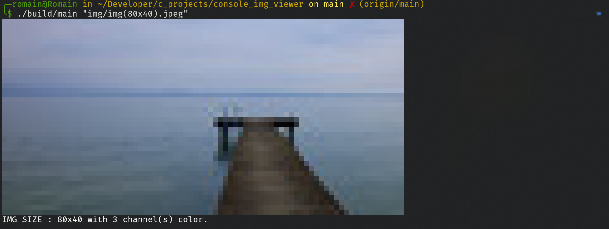
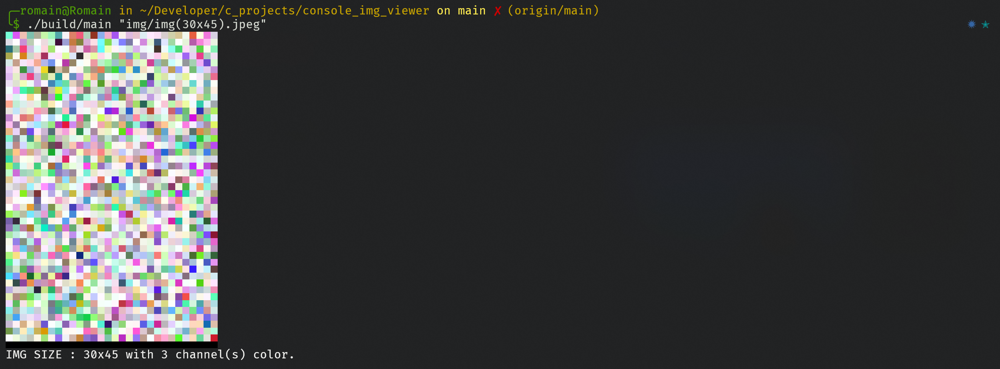

# console_img_viewer
Command line tool utility that allow you to display JPEG, PNG, GIF and WebP images directly into the console. Animated GIF and WebP are played in place. Images that are bigger than the terminal are automatically resized to fit inside it (the size of the font is taken into account to keep the right proportions), and JPEG photos are rotated following their EXIF orientation. 


<p align="center">
    
    
    <br />
    <i align="center">Screenshots of the result.</i>
</p>

# Build
This project depends on `libjpeg`, `libpng`, `giflib` and `libwebp`. On Fedora you can install them with:

```bash
sudo dnf install libjpeg-turbo-devel libpng-devel giflib-devel libwebp-devel
```

On Debian/Ubuntu:

```bash
sudo apt install libjpeg-dev libpng-dev libgif-dev libwebp-dev
```

You can create an executable file using the `makefile` in the project folder and executing this command:

```bash
make
```
After that, you can run the script by using the command:
```bash
./bin/tv [OPTION]... FILE...
```

| Option | Description |
|---|---|
| `-s`, `--size=COLSxROWS` | Terminal size, when it can't be detected. |
| `-w`, `--width=COLS` | Maximum width of the image in columns. |
| `-H`, `--height=ROWS` | Maximum height of the image in rows. |
| `-u`, `--upscale` | Enlarge small images up to the maximum size (they are only shrunk by default). |
| `--fit=MODE` | Terminal dimensions limiting the image: `both` (default), `width`, `height` or `none`. |
| `-C`, `--center` | Center the image horizontally. |
| `-c`, `--colors=MODE` | `truecolor`, `256`, `16`, `8` or `mono` (no color, only blocks). `auto` (default) uses `NO_COLOR`, `TERM` and `COLORTERM`. |
| `--dither=MODE` | How colors are approximated: `auto` (default: `fs` for images, `ordered` for animations), `fs` (Floyd-Steinberg), `ordered` or `none`. |
| `-a`, `--ascii` | Draw with ASCII characters (one per pixel, chosen by brightness). Used automatically when the locale is not UTF-8. |
| `--utf8` | Draw with half blocks even if the locale is not UTF-8. |
| `-l`, `--loop` | Play animations until `Ctrl-C` (they are played once by default). |
| `-n`, `--plays=N` | Play animations `N` times. |
| `-L`, `--file-loop` | Play animations as many times as the file says (GIF NETSCAPE loop count like browsers, WebP loop count). |
| `-f`, `--fps=N` | Draw at most `N` frames per second, frames are skipped but the animation keeps its speed (slow links). |
| `--frame=N` | Only display the frame `N` (from 1) of an animation. |
| `-i`, `--info` | Only print the format, size (after EXIF rotation), channels, frames, loop count and EXIF orientation of each image, one line per file. |
| `-h`, `--help` | Show the help. |
| `-V`, `--version` | Show the version. |

The terminal size is asked to the kernel, then read from `$COLUMNS` and `$LINES`, then asked to the terminal itself with an escape sequence. Serial consoles often report a `0x0` size to the kernel but most terminal emulators (picocom, minicom, screen...) answer the escape sequence. Use `-s` when nothing works.

## Colors and slow links
Each color change costs bytes, which matters on a serial link (115200 bauds is about 11KB/s). By default the color mode is detected from the environment:

| Environment | Colors |
|---|---|
| `NO_COLOR` set or `TERM=dumb` | `mono`: no escape sequence at all, only `▀ ▄ █` |
| `COLORTERM=truecolor` or `24bit` | `truecolor` |
| `TERM` containing `256color` | `256` |
| anything else (`vt220`, `linux`...) | `16` |

Consoles without UTF-8 can't draw the half blocks: when the locale is not UTF-8 (`LANG` unset, `C` or `POSIX`, common on embedded systems), the image is drawn with ASCII characters (` .:-=+*#%@`), one per pixel and colored unless in `mono`. `-a` forces it, `--utf8` disables it.

An 80x40 photo takes about 49KB in truecolor, 15KB in 16 colors and 4KB in mono. Dithering keeps the image readable with few colors; animations use an ordered dithering which stays stable between frames (Floyd-Steinberg would change most cells at each frame). `--dither=none` gives the smallest output.

`FILE` can be `-` to readthe image from the standard input, for example `ssh board cat /tmp/capture.png | tv -`. Pipes and devices can be read too.

`Ctrl-C` during an animation stops the program. When the output is redirected to a file, only the first frame of an animation is written.

Errors are written on `stderr` as `tv: <file>: <message>`. The exit code is `0` when every file was displayed, `1` when at least one file could not be displayed and `130` when the program was stopped with `Ctrl-C`.

You can also install `tv` system wide (default prefix is `/usr/local`):
```bash
sudo make install
```

# Project structure
```
srcs/               sources, main.c is at the root
├── cli/            command-line arguments parsing
├── decoders/       one decoder per image format (JPEG, PNG, GIF, WebP) and EXIF parsing
├── display/        terminal size, rendering and animation playback
├── image/          image creation, resizing, rotation and drawing
└── utils/          color conversion, error and file reading helpers
includes/           headers, same layout as srcs/
bin/                compiled executable (tv)
```

# Limitation 
Please note that the current version of this program only supports JPEG, PNG, GIF and WebP file formats (the format is detected from the file content, not its extension). Transparent pixels are displayed over a black background. Images are only shrunk to fit the terminal, use `-u` to enlarge small images. Feel free to implement other formats yourself! :)

# Licence
- romainflcht