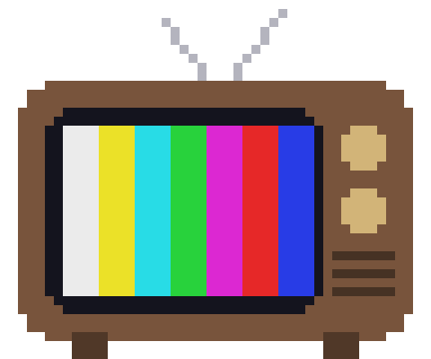
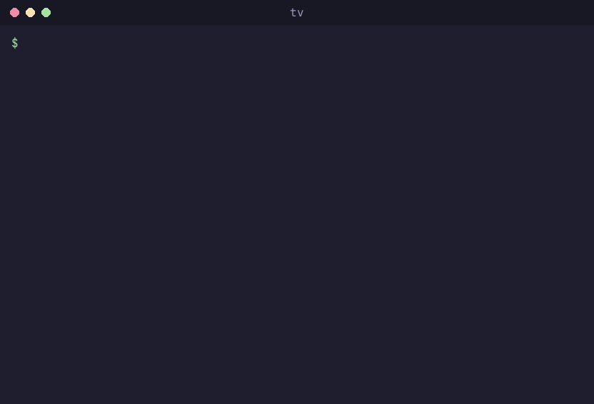
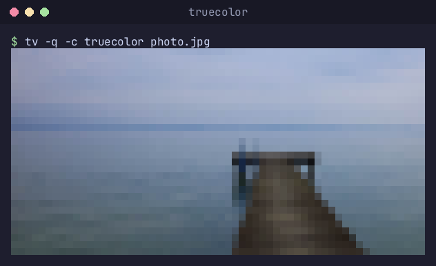
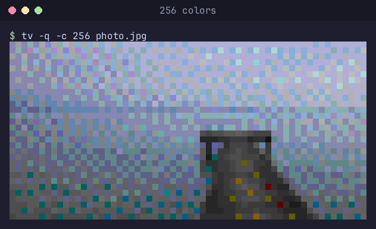
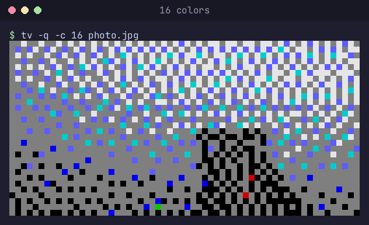
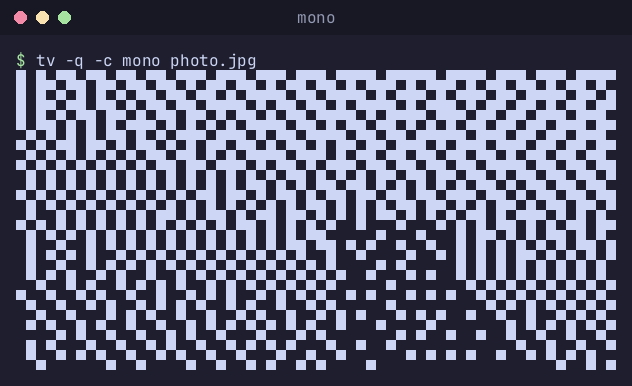
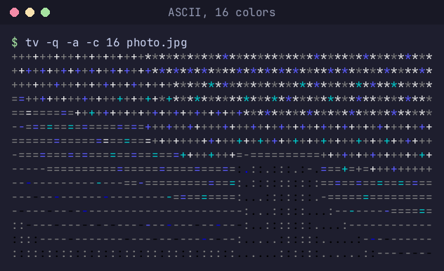
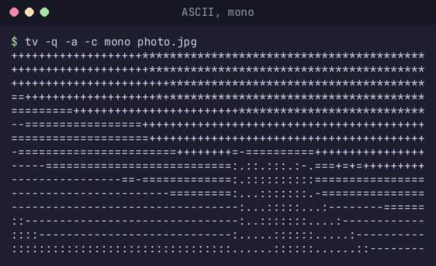
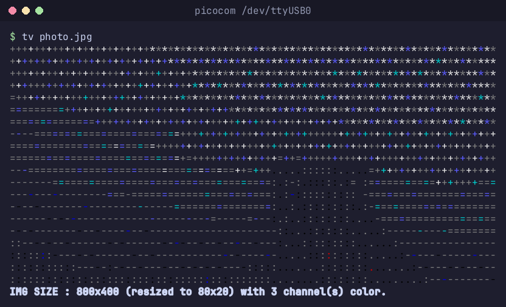
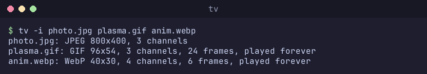

<p align="center">
  
</p>

<h1 align="center">tv</h1>

<p align="center">
  <b>Images in any terminal. Even over a serial cable.</b>
</p>

<p align="center">
  A tiny C tool to look at images on embedded Linux boards, serial consoles<br>
  and SSH sessions: no screen, no X server, no framebuffer needed.
</p>

<p align="center">
  <a href="LICENSE"></a>
  
  
  
</p>

<p align="center">
  <a href="#quick-start">Quick start</a> •
  <a href="#serial-consoles">Serial consoles</a> •
  <a href="#embedded-targets">Embedded targets</a> •
  <a href="#recipes">Recipes</a> •
  <a href="#options">Options</a> •
  <a href="#troubleshooting">Troubleshooting</a>
</p>

---

<p align="center">
  
</p>

## What is tv?

You are working on a board through its UART or an SSH session. A camera driver wrote `capture.png`, the UI renders a splash screen, a test dumped an image... and you want to **see it**, now, without copying files to your PC or plugging a screen.

`tv` draws the image right in the terminal with Unicode half blocks (two pixels per character) or plain ASCII. It finds the terminal size even through a serial link, reduces the colors and the amount of data for slow connections, and can be built as a **32 KB binary that only needs the libc**.

## Quick start

```bash
# 1. dependencies (all optional, see "Embedded targets" for a build without them)
sudo dnf install libjpeg-turbo-devel libpng-devel giflib-devel libwebp-devel

# 2. build
make

# 3. look at an image
./bin/tv photo.jpg
```

<details>
<summary><i>Dependencies on Debian, Ubuntu and Arch</i></summary>

```bash
sudo apt install libjpeg-dev libpng-dev libgif-dev libwebp-dev   # Debian, Ubuntu
sudo pacman -S libjpeg-turbo libpng giflib libwebp                # Arch
```
</details>

## Features

- **Works where graphics don't**: serial consoles, SSH, Linux virtual consoles, `screen`/`tmux`, any terminal with or without colors
- **Serial-aware**: finds the terminal size even when the kernel reports `0x0`, by asking the terminal itself through the serial link
- **Light on the wire**: truecolor, 256, 16, 8 colors or mono, with dithering; only changed colors are sent, animations only redraw the cells that changed
- **ASCII fallback**: switches to ASCII automatically when the console has no UTF-8
- **Tiny and dependency free when needed**: BMP and netpbm (PBM, PGM, PPM) are always built in, JPEG, PNG, GIF and WebP are optional
- **Plays animations**: GIF and WebP, in place, at the right speed, with a frame rate limit for slow links
- **Unix friendly**: reads `-` (stdin), pipes and devices, errors on stderr, meaningful exit codes, `NO_COLOR`, `-i` to inspect without drawing
- **Smart resizing**: fits the terminal, keeps the proportions of your font, decodes big JPEG photos directly at a smaller size, follows the EXIF orientation
- **Complete**: man page, bash and zsh completions, `make install`, cross compilation

## Same image, every mode

Each color change costs bytes, which matters at 115200 bauds (about 11 KB/s). The same 800x400 photo, drawn on 60x18 characters:

<table>
  <tr>
    <td align="center"><br><b>truecolor</b><br>30.4 KB · 2.7 s</td>
    <td align="center"><br><b>256 colors</b><br>16.9 KB · 1.5 s</td>
    <td align="center"><br><b>16 colors</b><br>8.4 KB · 0.7 s</td>
  </tr>
  <tr>
    <td align="center"><br><b>mono</b><br>2.3 KB · 0.2 s</td>
    <td align="center"><br><b>ASCII, 16 colors</b><br>4.0 KB · 0.4 s</td>
    <td align="center"><br><b>ASCII, mono</b><br>0.9 KB · 0.1 s</td>
  </tr>
</table>

<sub>Size of the output and time to send it at 115200 bauds. Soft, low contrast photos like this one lose a lot under 256 colors; logos, UI screenshots and test patterns stay clean. Mono and ASCII mono contain no escape sequence at all.</sub>

## Serial consoles

<p align="center">
  
</p>

On a serial console `TERM` is often `vt220` or `linux`, `LANG` is unset and the kernel doesn't know the size of the terminal. `tv` handles all of it **without any option**:

| What | How `tv` finds it |
|---|---|
| Terminal size | `-s` option → kernel (`TIOCGWINSZ`) → `$COLUMNS`/`$LINES` → asks the terminal itself (cursor position request, 500 ms timeout): the request goes through picocom, minicom or screen and the terminal of your PC answers |
| Colors | `NO_COLOR` or `TERM=dumb` → mono · `COLORTERM=truecolor` → truecolor · `TERM=*256color` → 256 · anything else → 16 |
| Characters | locale not UTF-8 (`LANG` unset, `C`, `POSIX`) → ASCII, otherwise half blocks |
| Proportions | from the font size when the terminal reports its size in pixels, 1:2 cells otherwise |

For animations over a slow link, limit the frame rate: frames are skipped but the animation keeps its speed.

```bash
tv -c 16 -f 5 -l animation.gif
```

## Embedded targets

### A build without any image library

JPEG, PNG, GIF and WebP need their library. Disable them to get a binary that only needs the libc; BMP and netpbm are always built in:

```bash
make WITH_JPEG=0 WITH_PNG=0 WITH_GIF=0 WITH_WEBP=0 CFLAGS=-Os
```

| Build | Size (stripped, `-Os`, x86_64) | Needs |
|---|---|---|
| Minimal | 32 KB | libc |
| Full | 57 KB | libc, libjpeg, libpng, giflib, libwebp |

`tv -V` lists the formats built in. On a minimal target, convert images to BMP or PPM before sending them (`magick capture.png capture.ppm`), or pipe them: `cat capture.ppm | ssh board tv -`.

### Cross compilation and packaging

`CC`, `CFLAGS`, `CPPFLAGS`, `LDFLAGS` and `LDLIBS` come from the command line, `PREFIX` and `DESTDIR` from the install:

```bash
make CC=aarch64-linux-gnu-gcc CFLAGS=-O2 WITH_WEBP=0 \
     CPPFLAGS=--sysroot=/opt/sysroot LDFLAGS=--sysroot=/opt/sysroot
make install DESTDIR=/tmp/rootfs PREFIX=/usr
```

`make install` installs the binary, the man page and the bash/zsh completions. Changing a build option rebuilds what is needed, no `make clean` required.

## Recipes

```bash
tv photo.jpg                               # fit the terminal
ssh board cat /tmp/capture.png | tv -      # an image from a board, without copying it
tv -i *.jpg                                # format, size, frames, EXIF orientation, no drawing
tv -t -q -w 40 *.png                       # several images, with their name, 40 columns wide
tv -c 16 -f 5 -l animation.gif             # play an animation forever over a slow link
tv --frame 3 animation.gif                 # a single frame of an animation
tv -s 100x30 photo.jpg                     # terminal size that can't be detected
tv -a -c mono -q -w 60 logo.png > logo.txt # plain ASCII art, no escape sequence
NO_COLOR=1 tv photo.jpg                    # no colors
```

<p align="center">
  
</p>

## Options

```
tv [OPTION]... FILE...
```

`FILE` can be `-` for the standard input. The full documentation is in `man tv`.

<details>
<summary><b>Size</b></summary>

| Option | Description |
|---|---|
| `-s`, `--size=COLSxROWS` | Terminal size, when it can't be detected. |
| `-w`, `--width=COLS` | Maximum width of the image in columns. |
| `-H`, `--height=ROWS` | Maximum height of the image in rows. |
| `-u`, `--upscale` | Enlarge small images up to the maximum size (they are only shrunk by default). |
| `--fit=MODE` | Terminal dimensions limiting the image: `both` (default), `width`, `height` or `none`. |
| `-C`, `--center` | Center the image horizontally. |
</details>

<details>
<summary><b>Colors and characters</b></summary>

| Option | Description |
|---|---|
| `-c`, `--colors=MODE` | `truecolor`, `256`, `16`, `8` or `mono` (no color, only blocks). `auto` (default) uses `NO_COLOR`, `TERM` and `COLORTERM`. |
| `--dither=MODE` | How colors are approximated: `auto` (default: `fs` for images, `ordered` for animations), `fs` (Floyd-Steinberg), `ordered` or `none` (smallest output). |
| `-a`, `--ascii` | Draw with ASCII characters (one per pixel, chosen by brightness). Used automatically when the locale is not UTF-8. |
| `--utf8` | Draw with half blocks even if the locale is not UTF-8. |
</details>

<details>
<summary><b>Animation</b></summary>

| Option | Description |
|---|---|
| `-l`, `--loop` | Play animations until `Ctrl-C` (they are played once by default). |
| `-n`, `--plays=N` | Play animations `N` times. |
| `-L`, `--file-loop` | Play animations as many times as the file says (GIF loop count like browsers, WebP loop count). |
| `-f`, `--fps=N` | Draw at most `N` frames per second; frames are skipped but the animation keeps its speed. |
| `--frame=N` | Only display the frame `N` (from 1) of an animation. |
</details>

<details>
<summary><b>Output and information</b></summary>

| Option | Description |
|---|---|
| `-q`, `--quiet` | Don't print the information line under images. |
| `-t`, `--title` | Print the file name before each image (`==> file <==`). |
| `-i`, `--info` | Only print the format, size, channels, frames, loop count and EXIF orientation of each image. |
| `-h`, `--help` | Show the help. |
| `-V`, `--version` | Show the version and the formats built in. |
</details>

**Exit status**: `0` every file was displayed, `1` a file could not be displayed (the error is on stderr as `tv: file: message`), `130` stopped with `Ctrl-C`.

## Formats

The format is detected from the content of the file, not its extension.

| Format | Library | Optional | Supported |
|---|---|---|---|
| JPEG | libjpeg | ✅ | baseline and progressive, grayscale, EXIF orientation, decoded at a smaller size for big photos |
| PNG | libpng | ✅ | every color type and bit depth, palette, transparency |
| GIF | giflib | ✅ | animations, transparency, disposal modes, interlacing, loop count |
| WebP | libwebp | ✅ | lossy and lossless, still and animated, transparency |
| BMP | none | built in | 1 to 32 bits, palette, bit fields, alpha, RLE4/RLE8, OS/2 and V2 to V5 headers |
| PBM, PGM, PPM | none | built in | P1 to P6, ASCII and binary, up to 16 bits |

Transparent pixels are drawn over black. CMYK JPEG are not supported.

## How it works

```
 one character cell              file ──▶ decoder ──▶ resize ──▶ colors ──▶ renderer
 ┌───────────┐                         JPEG, PNG,   fits the    truecolor  one write,
 │ top pixel │ ◀ background color      GIF, WebP,   terminal,   or palette only changed
 │───────────│                         BMP, PNM     font ratio  + dither   colors, only
 │ bottom    │ ◀ foreground color      EXIF         DCT scaling            changed cells
 └───────────┘   of the ▄ character    rotation     for JPEG               in animations
```

Each character cell shows two pixels: the `▄` character draws the bottom one in the foreground color, the top one is the background color. In ASCII mode a cell is one pixel, the character is chosen by brightness in ` .:-=+*#%@`.

## tv or chafa?

[chafa](https://hpjansson.org/chafa/) is the reference for images in terminals and does a lot more: many symbol sets, sixel, kitty and iTerm2 graphics. **On a desktop terminal, use chafa.**

`tv` is made for the other side: minimal root filesystems where GLib is not available, serial consoles, and links where every byte counts. Use it when you want a 32 KB binary with no dependency, a terminal size that is detected through a UART, and control over the amount of data sent.

## Troubleshooting

| Problem | Fix |
|---|---|
| The image is not resized on a serial console | The terminal doesn't answer the size request: use `-s 80x24`, or `export COLUMNS=80 LINES=24` |
| `â–„` or other strange characters | The terminal is not in UTF-8 but the locale says it is: use `-a` |
| ASCII is used but the terminal supports UTF-8 | The locale is not UTF-8 (`LANG` unset): `export LANG=C.UTF-8`, or `--utf8` |
| Colors are wrong or the image is grey | The terminal doesn't support the color mode: `-c 256`, `-c 16` or `-c 8` |
| Slow over a serial link | `-c 16` or `-c mono`, `--dither=none`, a smaller size with `-w 40`, `-f 5` for animations |
| The animation scrolls instead of playing in place | The image is taller than the terminal (`--fit=width` or `none`), or the output is not a terminal: only the first frame is drawn |
| `JPEG support was not compiled in` | Rebuild with `WITH_JPEG=1`, or convert the image to BMP or PPM |

## Project structure

```
srcs/               sources, main.c is at the root
├── cli/            command-line arguments parsing
├── decoders/       one decoder per format and EXIF parsing
├── display/        terminal size, colors, rendering and animation playback
├── image/          format detection, image creation, resizing and rotation
└── utils/          errors, file reading and color helpers
includes/           headers, same layout as srcs/
man/                man page (tv.1)
completions/        bash and zsh completions
docs/               README assets and the script that generates them
img/                sample images
```

The screenshots of this README are generated from the real output of `tv` by `docs/tools/screenshot.py` (Python and Pillow, after `make`).

## License

[MIT](LICENSE): use it, modify it, ship it in a product, sell it. Just keep the copyright notice.
